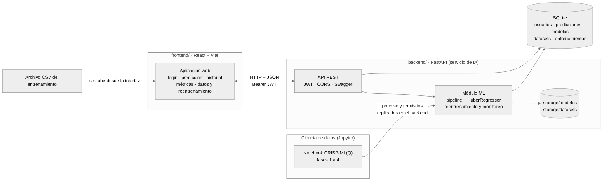
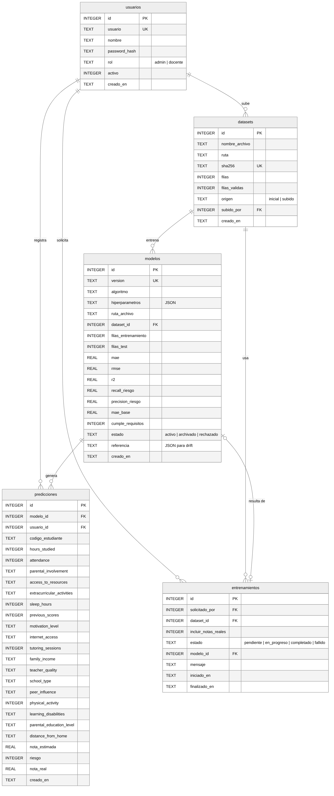

# EduPredict · Predicción del rendimiento académico

Sistema de IA que estima la **nota del examen final** de un estudiante (`Exam_Score`, de 0 a 100) a partir de sus hábitos y su entorno, y marca **en riesgo** a quien tenga una nota estimada menor a 65 para ofrecerle tutoría a tiempo.

Proyecto final de **Taller de Sistemas Inteligentes** · Universidad Católica Boliviana "San Pablo", Tarija.
Autor: Alex Jhonathan Choque Olguera.



## Componentes

El repositorio tiene dos proyectos **independientes** que se comunican solo por la API REST, y la parte de ciencia de datos:

| Carpeta | Qué contiene | Tecnología |
|---|---|---|
| [`ciencia-datos/`](ciencia-datos) | Notebook con las fases 1 a 4 de CRISP-ML(Q), dataset y artefactos del modelo | Python, scikit-learn, Jupyter |
| [`backend/`](backend) | Servicio de IA: API REST, modelo, reentrenamiento, monitoreo y base de datos | FastAPI, SQLite, scikit-learn, JWT |
| [`frontend/`](frontend) | Aplicación web que consume todos los endpoints de la API | React, Vite, Recharts |
| [`docs/`](docs) | Informe, Swagger, diagrama de base de datos, cronograma, capturas | — |

## Puesta en marcha rápida

Requisitos: **Python 3.11+** y **Node.js 20.19+** (recomendado Node 22 LTS).

```bash
# 1) Servicio de IA (terminal 1)
cd backend
python -m venv .venv
# Windows: .venv\Scripts\activate     Linux/Mac: source .venv/bin/activate
pip install -r requirements.txt
cp .env.example .env            # en Windows: copy .env.example .env
uvicorn app.main:app --reload --port 8000

# 2) Aplicación web (terminal 2)
cd frontend
npm install
cp .env.example .env            # en Windows: copy .env.example .env
npm run dev
```

- Aplicación web: http://localhost:5173
- Swagger (documentación interactiva de la API): http://localhost:8000/docs
- Usuarios de prueba: `admin / admin123` (administrador) y `docente / docente123` (docente)

La primera vez que arranca, la API crea la base de datos con [`backend/db/schema.sql`](backend/db/schema.sql) y entrena el modelo **v1** con los hiperparámetros encontrados en el notebook.
Para tener datos de ejemplo en el historial: `python scripts/cargar_demo.py` (desde `backend/`, con la API encendida).

## Endpoints de la API

| Requisito | Método y ruta |
|---|---|
| Enviar datos al modelo y obtener la predicción | `POST /api/predicciones` |
| Historial de predicciones (datos enviados y resultado) | `GET /api/predicciones` · `GET /api/predicciones/{id}` |
| Registrar la nota real de una predicción | `PUT /api/predicciones/{id}/nota-real` |
| Métricas de rendimiento del modelo | `GET /api/modelo/metricas` |
| Reentrenar el modelo con información actualizada | `POST /api/modelo/reentrenar` · `GET /api/modelo/entrenamientos/{id}` |
| Enviar el archivo de entrenamiento | `POST /api/datasets` (multipart, CSV) |
| Versiones, monitoreo de drift y contrato de entrada | `GET /api/modelo/versiones` · `GET /api/modelo/monitoreo` · `GET /api/modelo/contrato` |
| Autenticación | `POST /api/auth/login` · `GET /api/auth/yo` |

Documento Swagger exportado: [`docs/api/openapi.yaml`](docs/api/openapi.yaml) ([JSON](docs/api/openapi.json)).

## Base de datos



Script de creación: [`backend/db/schema.sql`](backend/db/schema.sql). Detalles en [`docs/base-de-datos`](docs/base-de-datos).

## Resultados del modelo (v1, conjunto de test)

| Métrica | Resultado | Requisito |
|---|---|---|
| MAE | 0,376 puntos | ≤ 1 |
| Mejora frente a predecir el promedio | 86,6 % | ≥ 50 % |
| R² | 0,819 | ≥ 0,70 |
| Recall de riesgo (nota < 65) | 1,000 | ≥ 0,90 |
| Precisión de riesgo | 0,811 | ≥ 0,70 |

Modelo: regresión de Huber (lineal robusta) con un pipeline de imputación, codificación ordinal y estandarización.

## Flujo de trabajo en Git

Ramas: `main` (versión entregable), `develop` (integración) y tres ramas de trabajo que se integran a `develop` con pull requests:
`feature/ciencia-datos`, `feature/api` y `feature/interfaz`. Detalle en [`docs/flujo_git.md`](docs/flujo_git.md).
Cada pull request ejecuta la integración continua (pruebas del backend y compilación del frontend) en GitHub Actions.

## Documentación

- Informe (CRISP-ML(Q), servicio y cliente web): [`docs/informe`](docs/informe)
- Cronograma CRISP-ML(Q): [`docs/cronograma`](docs/cronograma)
- Capturas de la aplicación: [`docs/capturas`](docs/capturas)

Dataset: [Student Performance Factors](https://www.kaggle.com/datasets/lainguyn123/student-performance-factors) (Kaggle).
