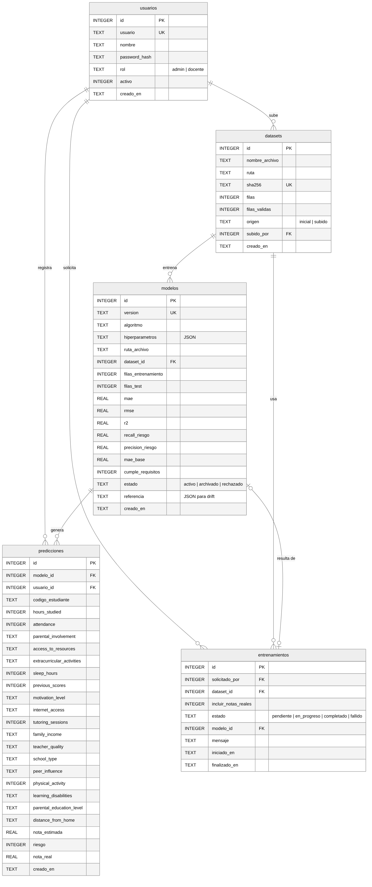

# Base de datos

Motor: **SQLite** (un solo archivo, `backend/storage/edupredict.db`, sin instalar un servidor).

| Tabla | Para qué sirve |
|---|---|
| `usuarios` | Docentes y administradores que usan la API (contraseña con bcrypt, rol). |
| `datasets` | Archivos de entrenamiento: el inicial y los que se suben por `POST /api/datasets`. El hash SHA-256 evita duplicados. |
| `modelos` | Cada versión del modelo con sus métricas de test, si cumple los requisitos, su estado (`activo`, `archivado`, `rechazado`) y la distribución de referencia para medir drift. |
| `entrenamientos` | Cada solicitud de reentrenamiento, su estado y el modelo que produjo. |
| `predicciones` | Historial: los 18 datos enviados, la nota estimada, si hay riesgo, el modelo y el usuario. La `nota_real` se completa después y sirve para monitorear y reentrenar. |

## Cómo generarla

El script es [`schema.sql`](schema.sql) (copia de `backend/db/schema.sql`). Hay tres formas:

1. **Automática**: al arrancar la API (`uvicorn app.main:app`) se ejecuta el script y se crean los usuarios y el modelo v1.
2. **Script de Python** (desde `backend/`): `python scripts/init_db.py`
3. **Consola de SQLite** (solo las tablas): `sqlite3 storage/edupredict.db < db/schema.sql`

El diagrama se genera desde [`diagrama_er.mmd`](diagrama_er.mmd) (Mermaid); GitHub lo muestra directamente.
