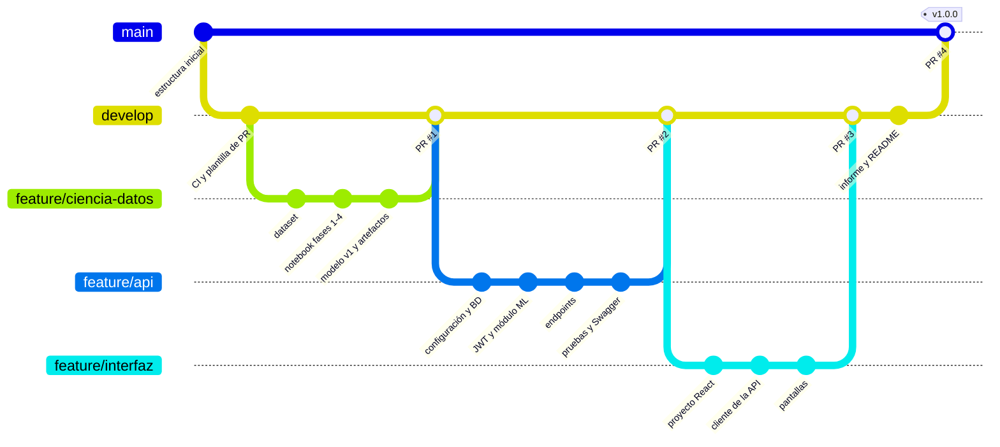

# Flujo de trabajo en Git

## Ramas

| Rama | Uso |
|---|---|
| `main` | Versión estable y entregable. Solo recibe cambios desde `develop` mediante pull request. |
| `develop` | Rama de integración. Recibe las ramas de trabajo mediante pull request. |
| `feature/ciencia-datos` | Notebook, dataset, artefactos del modelo y cronograma (fases 1 a 4). |
| `feature/api` | Servicio de IA: API REST, base de datos, reentrenamiento, monitoreo, Swagger (fases 5 y 6). |
| `feature/interfaz` | Aplicación web que consume la API. |

## Reglas

1. Nadie hace commits directos a `main`.
2. Cada rama de trabajo nace de `develop` y vuelve a `develop` con un **pull request**. Las ramas se crean en orden (ciencia de datos → API → interfaz) porque cada una usa lo anterior: la API reproduce el proceso del notebook y la interfaz consume la API.
3. Cada pull request ejecuta la integración continua (`.github/workflows/backend.yml` y `frontend.yml`): pruebas del backend y
   compilación del frontend. Solo se integra si pasa.
4. Los pull requests se revisan con apoyo de IA (revisión automática de código en GitHub) antes de integrarlos.
5. Al terminar, `develop` se integra a `main` y se crea la etiqueta `v1.0.0`.

## Convención de commits

`tipo(alcance): descripción`, por ejemplo `feat(api): endpoint de reentrenamiento` o `docs: diagrama de base de datos`.
Tipos usados: `feat`, `fix`, `docs`, `test`, `ci`, `chore`, `data`.
